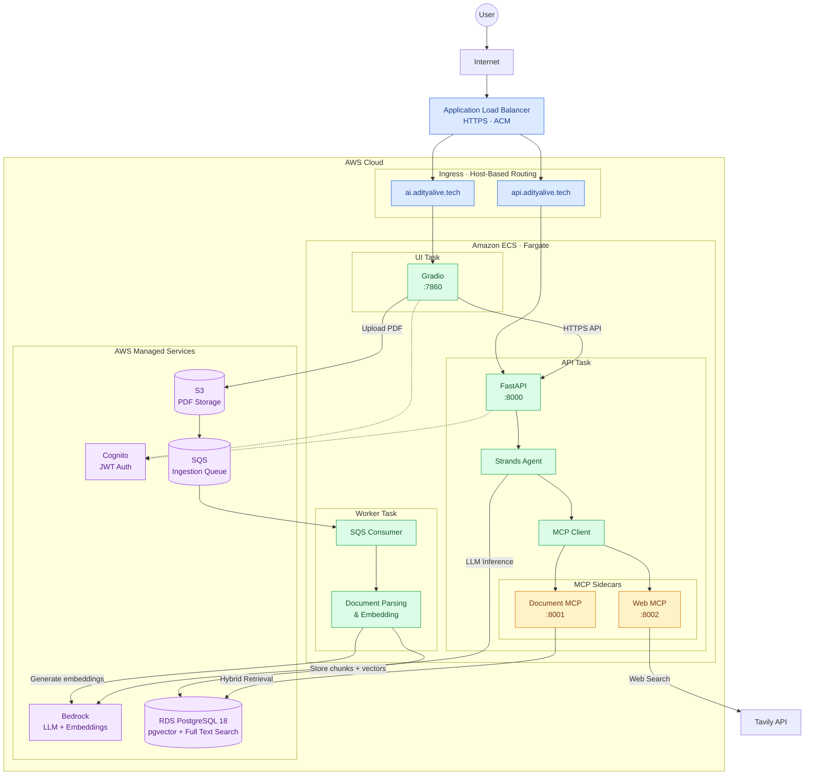

# Academic Intelligence Platform

[](https://github.com/MP-30/Academic-Intelligence-Platform/actions/workflows/ci.yml)
[](https://www.python.org/downloads/)
[](https://opensource.org/licenses/MIT)

Production RAG system that answers questions over academic PDFs with page-cited results. Agent routes between private document search and live web search via LLM tool selection. Tools are extracted into MCP servers — protocol-compliant and reusable across any MCP client.

**Live:** [https://ai.adityalive.tech](https://ai.adityalive.tech)

---

## What It Does

1. **Upload a PDF** (syllabus, lecture notes, paper) — stored in S3, ingestion queued in SQS
2. **Worker processes it** — page-aware chunking → Bedrock Titan v2 embeddings → stored in pgvector
3. **Ask a question** — hybrid search (vector similarity + full-text) fused via Reciprocal Rank Fusion
4. **Get a cited answer** — LLM synthesizes a response citing exact page numbers (`[Doc p.3]`)
5. **Agent decides what to search** — routes between your documents and the live web (Tavily) based on the question
6. **Tools exposed via MCP** — the same doc-search and web-search tools work with Claude Desktop, Cursor, or Cline

Every answer is verifiable — citations point to the exact PDF page the claim came from.
```
---

## Architecture

The platform runs on AWS ECS Fargate, with separate UI, API, and background worker tasks. An ALB handles HTTPS ingress and routes traffic based on hostnames.



---

## Tech Stack

| Layer | Technology |
|---|---|
| **Language** | Python 3.14 |
| **API** | FastAPI · Pydantic v2 |
| **Database** | PostgreSQL 18 + pgvector + tsvector |
| **ORM** | SQLAlchemy 2.0 (async via asyncpg; sync psycopg for worker) |
| **Migrations** | Alembic |
| **Embeddings** | Amazon Bedrock Titan v2 (1024-dim, normalized) |
| **LLM** | Amazon Bedrock Mistral Large 3 |
| **Agent SDK** | AWS Strands |
| **Tools protocol** | MCP SDK v2 (`mcp.server.MCPServer`) |
| **Web search** | Tavily API |
| **Auth** | AWS Cognito (JWT via JWKS) |
| **UI** | Gradio |
| **Async queue** | Amazon SQS (+ DLQ, 5-retry redrive) |
| **Container** | Docker (Python 3.14-slim · uv · psycopg) |
| **Orchestration** | ECS Fargate (3 tasks) |
| **Infra** | Terraform (see [infra repo](https://github.com/MP-30/academic-intelligence-platform-terraform)) |
| **CI/CD** | GitHub Actions · OIDC (zero stored AWS keys) |

---

## Quickstart (Local Development)

### Prerequisites

- Python 3.14+
- [uv](https://docs.astral.sh/uv/) package manager
- Docker + Docker Compose
- LocalStack Pro (`lstk` CLI) — for local S3 + SQS
- AWS account with Bedrock access (Titan v2 + Mistral enabled in `us-east-1`)
- Tavily API key (free tier: 1000 requests/month)

### Setup

```bash
# 1. Clone
git clone git@github.com:MP-30/Academic-Intelligence-Platform.git
cd Academic-Intelligence-Platform

# 2. Install dependencies (creates .venv + editable install)
uv sync
uv pip install -e .

# 3. Configure environment
cp .env.example .env
# Edit .env — set:
#   POSTGRES_USER, POSTGRES_PASSWORD, POSTGRES_DB
#   AWS_PROFILE (points to a profile with Bedrock access)
#   TAVILY_API_KEY
#   COGNITO_USER_POOL_ID, COGNITO_CLIENT_ID (see "AWS mode" below)

# 4. Start infra
docker compose up -d          # postgres on :5432
lstk restart --persist        # localstack on :4566 (S3 + SQS)

# 5. Create S3 bucket + SQS queues (once)
aws --endpoint-url=http://localhost:4566 s3 mb s3://academic-docs-local
aws --endpoint-url=http://localhost:4566 sqs create-queue --queue-name ingestion-jobs-dlq
# ... see docs/quickstart.md for full queue setup with DLQ policy

# 6. Run migrations
uv run alembic upgrade head

# 7. Start all services (API + worker + UI in one terminal)
make dev
```

**Open** http://localhost:7860

### Local testing with real AWS services

Production RDS is in a **private subnet** — unreachable from your laptop. For end-to-end local testing, use `.env.test` (local Postgres + real Cognito/Tavily/Bedrock):

```bash
cp .env.aws .env.test
# Edit .env.test — point DATABASE_URL at localhost:5432
set -a; source .env.test; set +a
uv run uvicorn academic_ai.main:app --port 8000
```

This gives you real auth (Cognito), real web search (Tavily), real LLM (Bedrock) — only the DB is local.

---

## Endpoints

All endpoints (except `/health` and `/auth/*`) require `Authorization: Bearer <jwt>` header.

| Method | Path | Purpose |
|---|---|---|
| `GET` | `/health` | Liveness probe (ALB health check) |
| `POST` | `/auth/register` | Create Cognito user |
| `POST` | `/auth/login` | Authenticate → returns `{id_token, access_token, refresh_token}` |
| `POST` | `/documents` | Upload PDF + enqueue ingestion job |
| `GET` | `/documents/{doc_id}` | Poll ingestion status (`PENDING` / `PROCESSING` / `READY` / `FAILED`) |
| `POST` | `/search` | Hybrid RRF search — returns raw chunks with page citations |
| `POST` | `/ask` | LLM answer over retrieved chunks (no tool routing) |
| `POST` | `/agent` | Strands agent — routes between doc search and web search via MCP tools |

### Example: `/agent` call

```bash
# 1. Login
TOKEN=$(curl -s -X POST https://api.adityalive.tech/auth/login \
  -H "Content-Type: application/json" \
  -d '{"email":"you@example.com","password":"yourpassword"}' \
  | jq -r .id_token)

# 2. Ask the agent
curl -s -X POST https://api.adityalive.tech/agent \
  -H "Authorization: Bearer $TOKEN" \
  -H "Content-Type: application/json" \
  -d '{
    "message": "What elective areas are offered?",
    "workspace_id": "your-workspace-uuid"
  }' | jq
```

**Response:**

```json
{
  "conversation_id": "d8e5d422-...",
  "response": "The elective areas are:\n- **Languages** (Hindi, English, other languages) [Doc p.3]\n- **Sciences** (Biology, Chemistry, Physics) [Doc p.3]...",
  "tool_calls": [
    {"tool": "search_course_documents", "args": {"query": "elective areas"}}
  ],
  "citations": [
    {"source": "document", "page_number": 3, "document_id": "...", "url": null, "title": null}
  ]
}
```

Multi-turn: pass `conversation_id` from the previous response to continue the same session.

---

## How It Works

### Ingestion Pipeline

```
PDF upload → S3 → SQS job → Worker (ECS Fargate)
                                │
                                ├─ Download PDF from S3
                                ├─ Parse page-by-page (pypdf)
                                ├─ Chunk: 600 tokens / 100 overlap (tiktoken)
                                ├─ Embed each chunk (Bedrock Titan v2, 1024-dim, normalized)
                                ├─ Bulk insert into document_chunks
                                └─ Update documents.processing_status = 'READY'
```

Worker is **idempotent** — `ON CONFLICT (document_id, chunk_index) DO NOTHING` means re-processing is safe. SQS retries with 5-attempt DLQ. `status == COMPLETED` guard short-circuits duplicate deliveries.

### Hybrid Retrieval (RRF)

Two retrievers run **in a single SQL query**:

1. **Semantic** — `embedding <=> query_embedding` (cosine distance via pgvector HNSW index)
2. **Keyword** — `search_vector @@ plainto_tsquery('english', query)` (tsvector GIN index)

Results fused via **Reciprocal Rank Fusion**:

```sql
COALESCE(1.0 / (60 + semantic_rank), 0.0) + COALESCE(1.0 / (60 + keyword_rank), 0.0)
```

The `FULL OUTER JOIN` keeps chunks found by **either** retriever. A chunk found only by keyword (exact match like "CS-401") still survives. The 60 constant dampens rank impact — the standard RRF formulation (Cormack et al., 2009).

### Agent + MCP

`/agent` runs a **Strands orchestrator** (Mistral Large 3) with two tools:

- `search_course_documents(query)` — MCP tool on `doc-mcp` sidecar (`:8001`)
- `search_web(query)` — MCP tool on `web-mcp` sidecar (`:8002`)

The LLM decides which tool(s) to call based on question type:

| Question type | Tool selected |
|---|---|
| "What's in my syllabus?" | `search_course_documents` |
| "Latest RAG research?" | `search_web` |
| "Compare my syllabus to industry" | **both** (sequential) |

**Multi-turn memory** is persisted in `conversations.llm_context_state` (JSONB) and `messages.content_blocks` (JSONB). Each request loads prior history and replays it to the LLM.

**Security:** The LLM never sees `user_id`. Auth is bound server-side into `X-User-Id` header on the MCP connection, and tools scope every query to that user at the SQL level. Tenant isolation is tested in CI (attacker user + real workspace → 0 rows).

---

## Testing

```bash
# Full test suite
uv run pytest tests/ -v

# Just tenant isolation (the critical test)
uv run pytest tests/test_tenant_isolation.py -v
```

**What's covered:**

- **`test_parser.py`** — page-aware chunking on fixture PDF (multi-page, contiguous `chunk_index`)
- **`test_tenant_isolation.py`** — three assertions:
  1. Attacker user + real workspace → **0 chunks**
  2. Real user + wrong workspace → **0 chunks**
  3. Real user + real workspace → **>0 chunks** (control — proves isolation isn't blocking everything)

CI runs the full suite + import smoke tests + Docker build on every push (see `.github/workflows/ci.yml`).

---

## Deployment

Manual button-triggered via GitHub Actions — full automation with **zero stored AWS credentials**.

### How to deploy

1. Open https://github.com/MP-30/Academic-Intelligence-Platform/actions/workflows/deploy.yml
2. Click **Run workflow**
3. Select service: `all` / `api` / `worker` / `ui`
4. Click **Run workflow**

**What it does:**

1. Assumes `GitHubActionsDeployRole` via **OIDC** (short-lived token, no stored secrets)
2. Builds Docker image (`linux/amd64`, matching ECS)
3. Pushes to ECR as `:latest`
4. Triggers `aws ecs update-service --force-new-deployment`
5. Waits for `aws ecs wait services-stable`
6. Hits `https://api.adityalive.tech/health` until `200` (retries 10×)

**Rollback:** re-run the workflow from a previous commit hash.

### Infrastructure

All AWS infra is provisioned by a separate Terraform repo: [academic-intelligence-platform-terraform](https://github.com/MP-30/academic-intelligence-platform-terraform)

Runs at **~$47/month** production cost.

---

## Project Structure

```
.
├── src/academic_ai/
│   ├── api/              FastAPI routers
│   │   ├── auth.py       /auth/register, /auth/login
│   │   ├── documents.py  /documents upload + status
│   │   ├── search.py     /search hybrid RRF
│   │   ├── ask.py        /ask LLM synthesis
│   │   ├── agent.py      /agent Strands + MCP
│   │   └── schemas.py    Pydantic request/response
│   │
│   ├── auth/             Cognito client + JWT verification
│   │   ├── cognito_client.py
│   │   └── dependencies.py  (JWKS verify)
│   │
│   ├── agents/           Strands orchestrator
│   │   ├── orchestrator.py  Agent factory + system prompt
│   │   ├── mcp_client.py    MCPClient factory per request
│   │   ├── context_manager.py  JSONB conversation load/save
│   │   └── tools/        (v0.4 in-process fallback path)
│   │
│   ├── mcp_servers/      Sidecar containers
│   │   ├── doc_server.py    search_course_documents (:8001)
│   │   └── web_server.py    search_web (:8002)
│   │
│   ├── ingestion/        Ingestion pipeline
│   │   ├── parser.py        page-aware chunking
│   │   ├── embeddings.py    Bedrock Titan v2
│   │   ├── s3_service.py    upload/download
│   │   ├── queue.py         SQS client + helpers
│   │   ├── producer.py      enqueue_ingestion_job
│   │   ├── worker.py        polling loop + handle_message
│   │   └── __main__.py      worker entrypoint
│   │
│   ├── retrieval/        Retrieval + synthesis
│   │   ├── hybrid_search.py  RRF SQL
│   │   └── ask.py            LLM synthesis
│   │
│   ├── db/               SQLAlchemy
│   │   ├── models.py     Document, DocumentChunk, Conversation, Message, IngestionJob
│   │   └── session.py    async engine + get_db
│   │
│   ├── ui/               Gradio app
│   │   └── app.py
│   │
│   ├── config.py         Pydantic settings
│   └── main.py           FastAPI app + routers
│
├── alembic/              Migrations
├── tests/                pytest suite
├── scripts/
│   ├── ecs_entrypoint.sh  5-mode dispatch (worker/api/ui/mcp-doc/mcp-web)
│   └── build_lambda.sh    (unused — kept for reference)
│
├── .github/workflows/
│   ├── ci.yml            Lint + test + Docker build
│   └── deploy.yml        Manual deploy (OIDC)
│
├── docker-compose.yml    Postgres for local dev
├── Dockerfile            Single image, 5 entrypoint modes
├── Makefile              dev, test, psql, urls, build-lambda
└── pyproject.toml        uv dependencies + ruff config
```

---

## Design Decisions

### Why Bedrock (not OpenAI)?

- **Compliance** — data stays in AWS, no third-party API calls
- **IAM auth** — no API keys to rotate for LLM/embeddings
- **Cost visibility** — one line item in AWS Cost Explorer

### Why pgvector (not Pinecone)?

- **One database** — relational + vectors + full-text + JSONB
- **Hybrid search in one query** — RRF fusion is a single SQL statement
- **Free tier** — no separate vector DB bill
- **Scales to ~1M vectors** — sufficient for this use case

### Why ECS Fargate (not Lambda)?

- **Private RDS access** — Lambda in VPC forces NAT (~$32/mo); Lambda outside VPC can't reach private RDS
- **EC2-free** — no instance patching
- **Sidecar support** — MCP servers run in the same task, no extra Fargate cost
- **Same Docker image** — migrates 1:1 to EKS at v0.12

### Why MCP (not in-process tools)?

- **Protocol compliance** — tools work with any MCP client (Claude Desktop, Cursor, Zed)
- **Reusability** — same server can be consumed by multiple agents
- **Foundation for A2A** — multi-agent orchestration (v0.10) requires protocol-level tools

---

## Roadmap

See [docs/ROADMAP.md](./docs/ROADMAP.md) for the full version history.

**Recently shipped:**
- ✅ **v0.6** — CI/CD pipelines (GitHub Actions + OIDC)
- ✅ **v0.5** — MCP servers as sidecar containers
- ✅ **v0.4** — Strands agent with tool routing

**Next up:**
- 📋 **v0.7** — Evals (RAGAS) with CI integration
- 📋 **v0.8** — Observability (OTel → Datadog)
- 📋 **v0.10** — Multi-agent A2A

---

## Documentation

- [Quickstart (detailed)](./docs/quickstart.md) — step-by-step first-time setup
- [Roadmap](./docs/ROADMAP.md) — version history and planned features
- [v0.5 Deep Dive — MCP](./docs/v0.5-mcp.md)
- [v0.6 Deep Dive — CI/CD](./docs/v0.6-cicd.md)

---

## Cost

Running in production at **~$47/month**:

| Service | Monthly |
|---|---|
| ECS Fargate (API + worker + UI tasks) | ~$36 |
| RDS `db.t3.micro` | $0 (free tier, 12mo) |
| ALB | ~$8 |
| Bedrock (embeddings + LLM) | ~$3 |
| S3, SQS, ECR, CloudWatch | ~$0.50 |
| **Total** | **~$47/month** |

---

## License

MIT — see [LICENSE](./LICENSE) for details.
```
