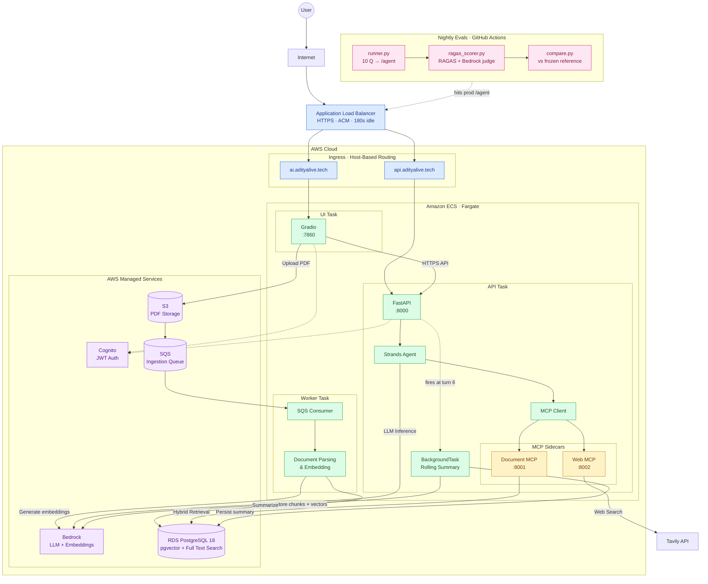

# Academic Intelligence Platform

[](https://github.com/MP-30/Academic-Intelligence-Platform/actions/workflows/ci.yml)
[](https://github.com/MP-30/Academic-Intelligence-Platform/actions/workflows/evals.yml)
[](https://www.python.org/downloads/)
[](https://opensource.org/licenses/MIT)

Production RAG system that answers questions over academic PDFs with page-cited results. An agent routes between private document search and live web search via LLM tool selection. Tools are extracted into MCP servers, making them protocol-compliant and reusable across any MCP client. Quality is gated nightly by a RAGAS eval suite; multi-turn conversations stay bounded via rolling summary compaction.

**Live:** [https://ai.adityalive.tech](https://ai.adityalive.tech)

**Latest eval baseline:** faithfulness 0.90 · context precision 0.98 · citation accuracy 0.75 · relevancy 0.84

---

## What It Does

1. **Upload a PDF** (syllabus, lecture notes, paper) — stored in S3, ingestion queued in SQS
2. **Worker processes it** — page-aware chunking → Bedrock Titan v2 embeddings → stored in pgvector
3. **Ask a question** — hybrid search (vector similarity + full-text) fused via Reciprocal Rank Fusion
4. **Get a cited answer** — the LLM synthesizes a response citing exact page numbers (`[Doc p.3]`)
5. **Agent decides what to search** — routes between your documents and the live web (Tavily) based on the question
6. **Multi-turn conversations stay bounded** — after 5 turns, older messages get summarized into a rolling summary; context size stays constant regardless of conversation length
7. **Tools exposed via MCP** — the same doc-search and web-search tools work with Claude Desktop, Cursor, or Cline
8. **Quality is measured, not assumed** — a RAGAS eval suite scores faithfulness, context precision, and citation accuracy nightly; regressions >5% fail CI against a frozen reference

Every answer is verifiable — citations point to the exact PDF page the claim came from, and every code change is measured against the eval baseline before it ships.

---

## Architecture

The platform runs on AWS ECS Fargate, with separate UI, API, and background worker tasks. An ALB handles HTTPS ingress and routes traffic based on hostnames. A separate nightly GitHub Actions workflow runs evals against production.



---

## Tech Stack

| Layer | Technology |
|---|---|
| **Language** | Python 3.14 |
| **API** | FastAPI · Pydantic v2 |
| **Database** | PostgreSQL 18 + pgvector + tsvector |
| **ORM** | SQLAlchemy 2.0 (async via asyncpg; sync psycopg for worker) |
| **Migrations** | Alembic |
| **Embeddings** | Amazon Bedrock Titan v2 (1024-dim, normalized) |
| **LLM** | Amazon Bedrock Mistral Large 3 |
| **Agent SDK** | AWS Strands |
| **Tools protocol** | MCP SDK v2 (`mcp.server.MCPServer`) |
| **Web search** | Tavily API |
| **Auth** | AWS Cognito (JWT via JWKS) |
| **UI** | Gradio |
| **Async queue** | Amazon SQS (+ DLQ, 5-retry redrive) |
| **Evals** | RAGAS · LLM-as-judge via Bedrock |
| **Container** | Docker (Python 3.14-slim · uv · psycopg) |
| **Orchestration** | ECS Fargate (3 tasks) |
| **Infra** | Terraform (see [infra repo](https://github.com/MP-30/academic-intelligence-platform-terraform)) |
| **CI/CD** | GitHub Actions · OIDC (zero stored AWS keys) |

---

## Quickstart (Local Development)

### Prerequisites

- Python 3.14+
- [uv](https://docs.astral.sh/uv/) package manager
- Docker + Docker Compose
- LocalStack Pro (`lstk` CLI) — for local S3 + SQS
- AWS account with Bedrock access (Titan v2 + Mistral enabled in `us-east-1`)
- Tavily API key (free tier: 1000 requests/month)

### Setup

```bash
# 1. Clone
git clone git@github.com:MP-30/Academic-Intelligence-Platform.git
cd Academic-Intelligence-Platform

# 2. Install dependencies (creates .venv + editable install)
uv sync

# 3. Configure environment
cp .env.example .env
# Edit .env — set:
#   POSTGRES_USER, POSTGRES_PASSWORD, POSTGRES_DB
#   AWS_PROFILE (points to a profile with Bedrock access)
#   TAVILY_API_KEY
#   COGNITO_USER_POOL_ID, COGNITO_CLIENT_ID

# 4. Start infra
docker compose up -d          # postgres on :5432
lstk restart --persist        # localstack on :4566 (S3 + SQS)

# 5. Create S3 bucket + SQS queues (once)
aws --endpoint-url=http://localhost:4566 s3 mb s3://academic-docs-local
aws --endpoint-url=http://localhost:4566 sqs create-queue --queue-name ingestion-jobs-dlq
# ... see docs/quickstart.md for the full queue setup with DLQ policy

# 6. Run migrations
uv run alembic upgrade head

# 7. Start all services (API + worker + UI in one terminal)
make dev
```

Then open <http://localhost:7860>.

### Local testing with real AWS services

Production RDS is in a **private subnet** — unreachable from your laptop. For end-to-end local testing, use `.env.test` (local Postgres + real Cognito/Tavily/Bedrock):

```bash
cp .env.aws .env.test
# Edit .env.test — point DATABASE_URL at localhost:5432
set -a; source .env.test; set +a
uv run uvicorn academic_ai.main:app --port 8000
```

This gives you real auth (Cognito), real web search (Tavily), and a real LLM (Bedrock) — only the DB is local.

### Running evals locally

The eval suite hits the deployed `/agent` endpoint (prod or local) and scores the responses with RAGAS. It requires Bedrock access for the judge LLM + embeddings.

```bash
# Score responses from prod
set -a; source .env.aws; set +a
make evals
```

Writes `tests/evals/baseline.json`. Compare against `tests/evals/baseline.reference.json` runs automatically as the third step.

---

## Endpoints

All endpoints (except `/health` and `/auth/*`) require an `Authorization: Bearer <jwt>` header.

| Method | Path | Purpose |
|---|---|---|
| `GET` | `/health` | Liveness probe (ALB health check) |
| `POST` | `/auth/register` | Create Cognito user |
| `POST` | `/auth/login` | Authenticate → returns `{id_token, access_token, refresh_token}` |
| `POST` | `/documents` | Upload PDF + enqueue ingestion job (no `workspace_id` required — defaults to `user_id`) |
| `GET` | `/documents/{doc_id}` | Poll ingestion status (`PENDING` / `PROCESSING` / `READY` / `FAILED`) |
| `POST` | `/search` | Hybrid RRF search — returns raw chunks with page citations |
| `POST` | `/ask` | LLM answer over retrieved chunks (no tool routing) |
| `POST` | `/agent` | Strands agent — routes between doc search and web search via MCP tools; supports multi-turn via `conversation_id`; returns `contexts` + `citations` |

### Example: `/agent` call

```bash
# 1. Login
TOKEN=$(curl -s -X POST https://api.adityalive.tech/auth/login \
  -H "Content-Type: application/json" \
  -d '{"email":"you@example.com","password":"yourpassword"}' \
  | jq -r .id_token)

# 2. Ask the agent (workspace_id optional — defaults to your user)
curl -s -X POST https://api.adityalive.tech/agent \
  -H "Authorization: Bearer $TOKEN" \
  -H "Content-Type: application/json" \
  -d '{"message": "What elective areas are offered?"}' | jq
```

**Response:**

```json
{
  "conversation_id": "d8e5d422-...",
  "response": "The elective areas are:\n- **Languages** (Hindi, English, other languages) [Doc p.3]\n- **Sciences** (Biology, Chemistry, Physics) [Doc p.3]...",
  "tool_calls": [
    {"tool": "search_course_documents", "args": {"query": "elective areas"}}
  ],
  "citations": [
    {"source": "document", "page_number": 3, "document_id": "...", "url": null, "title": null}
  ],
  "contexts": [
    " understanding about core business disciplines... Visual; Performing and Creative Arts...",
    " Skill Electives help in development of professional competencies..."
  ]
}
```

**Multi-turn:** pass the `conversation_id` from the previous response to continue the same session. After 5 turns, older messages are automatically compacted into a rolling summary (see [Memory Compaction](#memory-compaction)).

**`contexts`** contains the actual retrieved chunk text — useful for transparency (UI displays them in a collapsible inspector) and required for eval scoring (`faithfulness`, `context_precision`).

---

## How It Works

### Ingestion Pipeline

```text
PDF upload → S3 → SQS job → Worker (ECS Fargate)
                                │
                                ├─ Download PDF from S3
                                ├─ Parse page-by-page (pypdf)
                                ├─ Chunk: 600 tokens / 100 overlap (tiktoken)
                                ├─ Embed each chunk (Bedrock Titan v2, 1024-dim, normalized)
                                ├─ Bulk insert into document_chunks
                                └─ Update documents.processing_status = 'READY'
```

The worker is **idempotent** — `ON CONFLICT (document_id, chunk_index) DO NOTHING` means re-processing is safe. SQS retries up to 5 times before moving a message to the DLQ, and a `status == READY` guard short-circuits duplicate deliveries.

### Hybrid Retrieval (RRF)

Two retrievers run **in a single SQL query**:

1. **Semantic** — `embedding <=> query_embedding` (cosine distance via pgvector HNSW index)
2. **Keyword** — `search_vector @@ plainto_tsquery('english', query)` (tsvector GIN index)

Results are fused via **Reciprocal Rank Fusion**:

```sql
COALESCE(1.0 / (60 + semantic_rank), 0.0) + COALESCE(1.0 / (60 + keyword_rank), 0.0)
```

The `FULL OUTER JOIN` keeps chunks found by **either** retriever, so a chunk found only by keyword (an exact match like "CS-401") still survives. The constant 60 dampens the impact of rank differences — the standard RRF formulation (Cormack et al., 2009).

### Agent + MCP

`/agent` runs a **Strands orchestrator** (Mistral Large 3) with two tools:

- `search_course_documents(query)` — MCP tool on the `doc-mcp` sidecar (`:8001`)
- `search_web(query)` — MCP tool on the `web-mcp` sidecar (`:8002`)

The LLM decides which tool(s) to call based on question type:

| Question type | Tool selected |
|---|---|
| "What's in my syllabus?" | `search_course_documents` |
| "Latest RAG research?" | `search_web` |
| "Compare my syllabus to industry" | **both** (sequential) |

**Multi-turn memory** persists user + assistant turns in the `messages` table and a rolling summary in `conversations.rolling_summary`.

**Security:** The LLM never sees `user_id`. Auth is bound server-side into an `X-User-Id` header on the MCP connection, and tools scope every query to that user at the SQL level. Tenant isolation is tested in CI (attacker user + real workspace → 0 rows).

### Memory Compaction

Long conversations without compaction blow up the LLM context window and cause request timeouts. This project uses **rolling summary compaction**:

```text
Turn 5  ──────────►  [10 messages unsummarized]  no compaction (below trigger)
Turn 6  ──────────►  [12 messages]  →  compact 4 into summary, keep 8 verbatim
Turn 7  ──────────►  [10 unsummarized]  no-op
Turn 8  ──────────►  [12 unsummarized]  →  compact 4 more into rolling summary
Turn 9  ──────────►  [10 unsummarized]  no-op
...
Steady state:  rolling summary (~200 words) + 8 verbatim messages
```

**Key properties:**
- **Background task** — compaction fires *after* the response is sent via FastAPI `BackgroundTasks`, so users never wait for the Bedrock summarization call
- **Mark-summarized, not delete** — `messages.summarized = TRUE` preserves history for analytics; context loading filters on this flag
- **Rolling, not fixed** — each compaction merges new turns into the existing summary (prompt: *"merge new turns into previous summary, don't repeat"*), so the invariant holds regardless of conversation length
- **Configurable trigger** — `summary_trigger_turns = 5`, `recent_messages_keep = 8` (messages, not turns). Trigger chosen so compaction fires before accumulated history causes ALB timeout (180s)

Trade-off: compaction loses some verbatim detail from older turns. On the eval suite, faithfulness stays within 0.02 of the uncompacted baseline (see [Evals](#evals)).

### Evals

The eval suite runs nightly against production and gates the pipeline on regression. Four metrics per run:

| Metric | What it measures | Judge |
|---|---|---|
| **faithfulness** | Do the answer's claims appear in the retrieved chunks? (hallucination) | RAGAS LLM |
| **answer_relevancy** | Does the answer actually address the question? (verbosity) | RAGAS embeddings |
| **context_precision** | Are the retrieved chunks relevant to the ground truth? (retrieval quality) | RAGAS LLM |
| **citation_accuracy** | Do the cited pages match `expected_pages` in the dataset? (custom) | Deterministic |

**How it works:**

```text
tests/evals/dataset.yaml     ← 10 questions (doc/mixed/web/refusal)
              │
              ▼
tests/evals/runner.py        ← POST /agent, capture response + contexts
              │
              ▼
tests/evals/ragas_scorer.py  ← RAGAS evaluate() with Bedrock judge
              │
              ▼
tests/evals/baseline.json    ← latest run (gitignored)
              │
              ▼
tests/evals/compare.py       ← vs baseline.reference.json, exit 1 if metric drops >0.05
```

**Why nightly, not per-push:** RAGAS's LLM-as-judge has ~2pp inherent variance per metric (the judge re-parses answers slightly differently each run). Per-push gating with a 0.05 threshold would fail randomly on judge noise, not real regressions. Nightly gating gives 10× the variance headroom.

**Guards against partial runs:**

- `ragas_scorer.py` enforces `MIN_SCORED = 0.8` per metric — if any metric has >20% `NaN` rows, it refuses to write `baseline.json`
- `compare.py` exits 1 if `reference.count` and `current.count` differ by >2 — prevents comparing partial runs against full references

**The eval found a real bug at v0.7 ship:** the initial `faithfulness = 1.0` was a fake metric. `/agent` wasn't returning retrieved chunk text, so RAGAS fell back to comparing the answer against itself. Fixing it required adding a `contexts` field to `AgentResponse` — an API change, not an eval change. The eval surfaced a production bug it couldn't have caught without a code fix.

---

## Testing

```bash
# Full test suite
uv run pytest tests/ -v

# Just tenant isolation (the critical test)
uv run pytest tests/test_tenant_isolation.py -v
```

**What's covered:**

- **`test_parser.py`** — page-aware chunking on a fixture PDF (multi-page, contiguous `chunk_index`)
- **`test_tenant_isolation.py`** — three assertions:
  1. Attacker user + real workspace → **0 chunks**
  2. Real user + wrong workspace → **0 chunks**
  3. Real user + real workspace → **>0 chunks** (control — proves isolation isn't blocking everything)

**Manual verification of compaction:** `tests/manual/test_compaction.py` inserts 12 turns, mocks Bedrock, asserts history trims to summary + 8 messages. Run with `uv run python -m tests.manual.test_compaction`.

**Evals:** see [Evals](#evals) above. Run with `make evals`.

CI runs the full suite, import smoke tests, and a Docker build on every push (see `.github/workflows/ci.yml`). The nightly eval workflow (`.github/workflows/evals.yml`) runs the RAGAS suite separately.

---

## Deployment

Two automated workflows — deploy is a button, evals run nightly.

### Deploy (`deploy.yml`) — manual trigger

1. Open <https://github.com/MP-30/Academic-Intelligence-Platform/actions/workflows/deploy.yml>
2. Click **Run workflow**
3. Select service: `all` / `api` / `worker` / `ui`
4. Click **Run workflow**

**What it does:**

1. Assumes `GitHubActionsDeployRole` via **OIDC** (short-lived token, no stored secrets)
2. Builds the Docker image (`linux/amd64`, matching ECS)
3. Pushes to ECR as `:latest`
4. Triggers `aws ecs update-service --force-new-deployment`
5. Waits for `aws ecs wait services-stable`
6. Polls `https://api.adityalive.tech/health` until it returns `200` (retries 10×)

**Rollback:** re-run the workflow from a previous commit hash.

### Evals (`evals.yml`) — nightly + manual trigger

1. Runs at **03:00 UTC daily**, or on-demand
2. Hits production `/agent` with 10 test questions
3. Scores with RAGAS (Bedrock judge)
4. Compares against `baseline.reference.json`
5. Exits 1 on regression >0.05 → **pipeline fails on quality regression**

On failure, the workflow dumps AWS identity, env vars (masked), and available Bedrock models — so the next red run is self-diagnosing instead of a guessing game.

### Infrastructure

All AWS infra is provisioned by a separate Terraform repo: [academic-intelligence-platform-terraform](https://github.com/MP-30/academic-intelligence-platform-terraform)

Runs at **~$63/month** in production (see [Cost](#cost)).

---

## Project Structure

```text
.
├── src/academic_ai/
│   ├── api/              FastAPI routers
│   │   ├── auth.py       /auth/register, /auth/login
│   │   ├── documents.py  /documents upload + status
│   │   ├── search.py     /search hybrid RRF
│   │   ├── ask.py        /ask LLM synthesis
│   │   ├── agent.py      /agent Strands + MCP + compaction background task
│   │   └── schemas.py    Pydantic request/response (contexts field)
│   │
│   ├── auth/             Cognito client + JWT verification
│   │   ├── cognito_client.py
│   │   └── dependencies.py  (JWKS verify)
│   │
│   ├── agents/           Strands orchestrator
│   │   ├── orchestrator.py  Agent factory + system prompt
│   │   ├── mcp_client.py    MCPClient factory per request
│   │   ├── context_manager.py  load_history + save_turn + compact_if_needed
│   │   ├── prompts/
│   │   │   └── summary.md   Rolling summary prompt
│   │   └── tools/        (v0.4 in-process fallback path)
│   │
│   ├── mcp_servers/      Sidecar containers
│   │   ├── doc_server.py    search_course_documents (:8001)
│   │   └── web_server.py    search_web (:8002)
│   │
│   ├── ingestion/        Ingestion pipeline
│   │   ├── parser.py        page-aware chunking
│   │   ├── embeddings.py    Bedrock Titan v2
│   │   ├── s3_service.py    upload/download
│   │   ├── queue.py         SQS client + helpers
│   │   ├── producer.py      enqueue_ingestion_job
│   │   ├── worker.py        polling loop + handle_message
│   │   └── __main__.py      worker entrypoint
│   │
│   ├── retrieval/        Retrieval + synthesis
│   │   ├── hybrid_search.py  RRF SQL
│   │   └── ask.py            LLM synthesis
│   │
│   ├── db/               SQLAlchemy
│   │   ├── models.py     Document, DocumentChunk, Conversation, Message, IngestionJob
│   │   └── session.py    async engine + get_db
│   │
│   ├── ui/               Gradio app (uses /agent, multi-turn)
│   │   └── app.py
│   │
│   ├── config.py         Pydantic settings (compaction trigger, eval judge)
│   └── main.py           FastAPI app + routers
│
├── alembic/              Migrations
├── docs/                 Quickstart, roadmap, version deep dives
├── tests/
│   ├── evals/            RAGAS eval suite
│   │   ├── dataset.yaml          10 questions
│   │   ├── runner.py             POST /agent, capture responses
│   │   ├── ragas_scorer.py       RAGAS evaluate() with guards
│   │   ├── compare.py            vs frozen reference
│   │   ├── baseline.json         latest run (gitignored)
│   │   └── baseline.reference.json   frozen baseline
│   ├── manual/
│   │   └── test_compaction.py    Mocked-Bedrock compaction test
│   ├── test_parser.py
│   ├── test_tenant_isolation.py
│   └── conftest.py
│
├── scripts/
│   ├── ecs_entrypoint.sh  5-mode dispatch (worker/api/ui/mcp-doc/mcp-web)
│   └── build_lambda.sh    (unused — kept for reference)
│
├── .github/workflows/
│   ├── ci.yml            Lint + test + Docker build
│   ├── deploy.yml        Manual deploy (OIDC)
│   └── evals.yml         Nightly RAGAS eval gate
│
├── docker-compose.yml    Postgres for local dev
├── Dockerfile            Single image, 5 entrypoint modes
├── Makefile              dev, test, evals, psql, urls, build-lambda
└── pyproject.toml        uv dependencies + ruff config
```

---

## Design Decisions

### Why Bedrock (not OpenAI)?

- **Compliance** — data stays in AWS, no third-party LLM API calls
- **IAM auth** — no API keys to rotate for LLM/embeddings
- **Cost visibility** — one line item in AWS Cost Explorer

### Why pgvector (not Pinecone)?

- **One database** — relational + vectors + full-text + JSONB
- **Hybrid search in one query** — RRF fusion is a single SQL statement
- **No extra bill** — no separate vector DB to pay for
- **Scales to ~1M vectors** — sufficient for this use case

### Why ECS Fargate (not Lambda)?

- **Private RDS access** — Lambda in a VPC forces a NAT gateway (~$32/mo) for outbound calls; Lambda outside the VPC can't reach private RDS
- **EC2-free** — no instance patching
- **Sidecar support** — MCP servers run in the same task, no extra Fargate cost
- **Same Docker image** — migrates 1:1 to EKS at v0.12

### Why MCP (not in-process tools)?

- **Protocol compliance** — tools work with any MCP client (Claude Desktop, Cursor, Zed)
- **Reusability** — the same server can be consumed by multiple agents
- **Foundation for A2A** — multi-agent orchestration (v0.10) requires protocol-level tools

### Why nightly evals (not per-push)?

- **LLM-as-judge variance** — RAGAS has ~2pp inherent variance per metric. Per-push gating with a 0.05 threshold fails randomly on judge noise, not real regressions
- **Cost** — 30 judge calls × 30 nights = ~$15/mo. Per-push would add ~$150/mo (30 pushes/day × $0.50)
- **Coverage** — evals measure quality, CI measures correctness. They're complementary layers, not substitutes

For high-frequency changes (prompt tweaks, retrieval tuning), a manual `make evals` before commit gives same-day signal without 24h lag.

### Why rolling summary (not fixed)?

- **Fixed** fails at turn 30 — verbatim tail grows unboundedly again
- **Rolling** preserves the invariant: context size stays constant regardless of conversation length
- **Implementation** is prompt engineering: each compaction gets `previous_summary + new_turns` and merges. The rolling prompt has 3 cases to handle (first compaction, merge new turns, dedup redundant content)
- **Trade-off** — loses verbatim detail from older turns. Baseline faithfulness stays within 0.02 of the uncompacted state

### Why ALB timeout 180s (not default 60s)?

- **LLM workloads** — 3-15s per Bedrock call, 30-90s per multi-turn request with large context
- **60s default** kills mid-request, returning HTML 504 that breaks JSON parsers
- **180s** gives ~2× headroom over typical multi-turn latency
- **Real fix** is keeping requests fast (response cap + compaction), not just bumping timeout. Timeout is a safety margin, not a substitute for performance

---

## Roadmap

See [docs/ROADMAP.md](./docs/ROADMAP.md) for the full version history.

**Recently shipped:**

- ✅ **v0.9** — Memory compaction (rolling summary, background task)
- ✅ **v0.7** — Evals (RAGAS) with nightly CI gate
- ✅ **v0.6** — CI/CD pipelines (GitHub Actions + OIDC)
- ✅ **v0.5** — MCP servers as sidecar containers
- ✅ **v0.4** — Strands agent with tool routing

**Next up:**

- 📋 **v0.7.1** — Eval polish (30-question dataset, citation completeness metric)
- 📋 **v0.10** — Multi-agent A2A (HTTP, not AgentCore)
- 📋 **v0.8** — Observability (deferred — will revisit with v0.12 EKS)

---

## Documentation

- [Quickstart (detailed)](./docs/quickstart.md) — step-by-step first-time setup
- [Roadmap](./docs/ROADMAP.md) — version history and planned features
- [v0.5 Deep Dive — MCP](./docs/v0.5-mcp.md)
- [v0.6 Deep Dive — CI/CD](./docs/v0.6-cicd.md)
- [v0.7 Deep Dive — Evals](./docs/v0.7-evals.md)
- [v0.9 Deep Dive — Memory Compaction](./docs/v0.9-memory.md)

---

## Cost

Running in production at **~$63/month**:

| Service | Monthly |
|---|---|
| ECS Fargate (API + worker + UI tasks) | ~$36 |
| RDS `db.t3.micro` | $0 (free tier, first 12 months) |
| ALB | ~$8 |
| Bedrock (embeddings + LLM + **eval runs**) | ~$18 |
| S3, SQS, ECR, CloudWatch | ~$0.50 |
| **Total** | **~$63/month** |

> RDS cost is $0 only while the 12-month free tier lasts; expect the total to rise afterwards. Bedrock cost includes ~$15/mo for nightly eval runs (30 judge calls/night × ~$0.50/run).

---

## License

MIT — see [LICENSE](./LICENSE) for details.